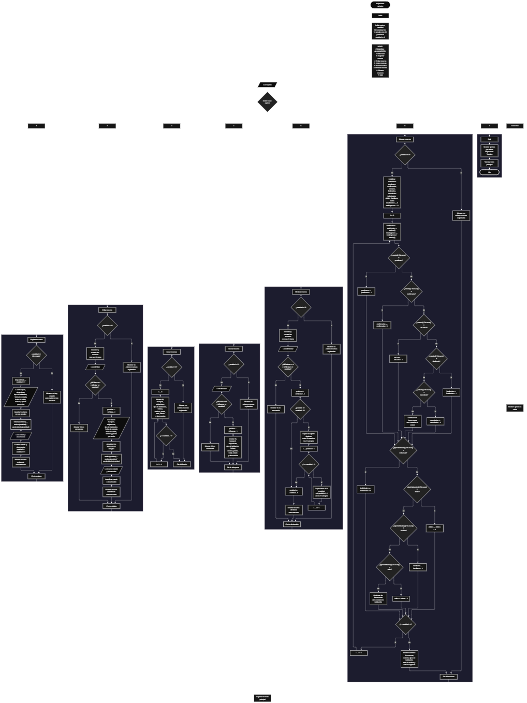

Este proyecto, llamado <b>alojamiento turístico</b>, fue desarrollado en <b>visual basic .net</b> como un ejercicio práctico para fortalecer la lógica de programación mediante la creación de un sistema de gestión de reservas de alojamientos desde la consola. El programa cuenta con un menú principal de siete opciones que permite <b>registrar, editar, eliminar, buscar y listar reservas, además de mostrar un resumen general</b> de la información almacenada. Cada reserva contiene datos como el huésped, el alojamiento, el tipo de habitación, las fechas de entrada y salida, la cantidad de noches, el precio por noche, el total, el estado y las observaciones. Para administrar esta información se utilizan arreglos paralelos con una capacidad máxima de <b>10 reservas durante la ejecución</b>. También se implementan cálculos automáticos para obtener el importe total de cada reserva y contadores para clasificar los registros según su estado y tipo de habitación. Durante su desarrollo se aplicaron conceptos fundamentales de programación, como variables, arreglos, estructuras condicionales, ciclos repetitivos, estructuras de selección, contadores y acumuladores.

<h2 align="center">⚙️ Funcionamiento del menú principal</h2>

### ➕ Registrar reserva

La opción <b>1) registrar reserva</b> permite almacenar una nueva reserva de alojamiento. Antes de realizar el registro, el sistema comprueba que la cantidad de reservas sea menor que la capacidad de los arreglos, mediante la condición <b>cantidad &gt;= ids.Length</b>. Si se alcanza la capacidad máxima de <b>10 reservas</b>, muestra el mensaje <b>"no hay espacio para registrar más reservas."</b>, impidiendo agregar otro registro. Si existe espacio disponible, asigna un identificador utilizando la expresión <b>cantidad + 1</b> y solicita los datos del huésped, alojamiento, tipo de habitación, fecha de entrada, fecha de salida, cantidad de noches, precio por noche, estado y observación. Después, calcula automáticamente el importe total mediante la operación <b>noches(cantidad) * preciosNoche(cantidad)</b> y almacena el resultado en el arreglo <b>totales</b>. Finalmente, aumenta la variable <b>cantidad</b> en uno y muestra el mensaje <b>"reserva registrada correctamente."</b>.

### ✏️ Editar reserva

La opción <b>2) editar reserva</b> permite modificar los datos de una reserva registrada. Primero, el programa comprueba si existen reservas almacenadas mediante la variable <b>cantidad</b>. Si no hay registros, muestra el mensaje <b>"no existen reservas registradas."</b>. En caso contrario, utiliza un ciclo <b>For...Next</b> para mostrar la información de todas las reservas, incluyendo el ID, huésped, alojamiento, tipo de habitación, fechas, noches, precio por noche, total, estado y observación. Después, solicita el identificador de la reserva que se desea editar y comprueba que esté dentro del rango permitido mediante la condición <b>idEditar &gt;= 1 And idEditar &lt;= cantidad</b>. Si el identificador es válido, calcula la posición correspondiente utilizando <b>idEditar - 1</b> y solicita los nuevos datos de la reserva. Se actualizan todos los campos, excepto el identificador, y se vuelve a calcular el importe total mediante <b>noches(posicion) * preciosNoche(posicion)</b>. Finalmente, muestra el mensaje <b>"reserva actualizada correctamente."</b>. Si el identificador no está dentro del rango permitido, presenta el mensaje <b>"ID no encontrada."</b>.

### 📋 Listar reservas

La opción <b>3) listar reservas</b> permite visualizar todas las reservas almacenadas durante la ejecución del programa. Primero, comprueba si la variable <b>cantidad</b> es igual a cero. Si no existen registros, muestra el mensaje <b>"no existen reservas registradas."</b>. Si hay reservas disponibles, utiliza un ciclo <b>For...Next</b> para recorrer los arreglos desde la posición <b>0</b> hasta <b>cantidad - 1</b>. Durante el recorrido, muestra los datos de cada reserva, incluyendo su identificador, huésped, alojamiento, tipo de habitación, fechas de entrada y salida, noches, precio por noche, total, estado y observación. Esta opción permite consultar de manera general toda la información almacenada sin necesidad de seleccionar una reserva individualmente.

### 🔎 Buscar reserva

La opción <b>4) buscar reserva</b> permite consultar la información completa de una reserva mediante su identificador. Primero, el programa comprueba si existen reservas registradas. Si la cantidad es igual a cero, muestra el mensaje <b>"no existen reservas registradas."</b>. En caso contrario, solicita el ID de la reserva que se desea buscar y verifica que esté dentro del rango permitido mediante la condición <b>idBuscar &gt;= 1 And idBuscar &lt;= cantidad</b>. Si el identificador es válido, calcula la posición utilizando <b>idBuscar - 1</b> y muestra todos los datos almacenados en los arreglos correspondientes. Si el ID introducido no está dentro del rango permitido, presenta el mensaje <b>"ID no encontrada."</b>. Esta operación facilita localizar y consultar los datos de una reserva específica.

### 🗑️ Eliminar reserva

La opción <b>5) eliminar reserva</b> permite eliminar una reserva mediante su identificador. Antes de realizar el proceso, el programa comprueba si existen reservas almacenadas. Si no hay registros, muestra el mensaje <b>"no existen reservas registradas."</b>. Si existen reservas, utiliza un ciclo <b>For...Next</b> para presentar la información de todas ellas. Después, solicita el ID de la reserva que se desea eliminar y comprueba que esté dentro del rango permitido. Si el identificador es válido, obtiene su posición mediante <b>idEliminar - 1</b> y utiliza otro ciclo <b>For...Next</b> para desplazar una posición hacia la izquierda los datos de las reservas posteriores. Este procedimiento reorganiza los valores de los once arreglos: <b>ids, huespedes, alojamientos, tiposHabitacion, fechasEntrada, fechasSalida, noches, preciosNoche, totales, estados y observaciones</b>. Finalmente, disminuye la variable <b>cantidad</b> en uno y muestra el mensaje <b>"reserva eliminada correctamente."</b>. Si el ID no está dentro del rango permitido, presenta el mensaje <b>"ID no encontrada."</b>.

### 📊 Mostrar resumen

La opción <b>6) mostrar resumen</b> permite obtener una visión general de las reservas registradas mediante contadores y acumuladores. Primero, el programa comprueba si existen reservas almacenadas. Si la cantidad es igual a cero, muestra el mensaje <b>"no existen reservas registradas."</b>. En caso contrario, inicializa los contadores <b>pendientes, confirmadas, enCurso, finalizadas y canceladas</b> para clasificar las reservas según su estado. También inicializa los contadores <b>individuales, dobles, familiares y suites</b> para clasificarlas según el tipo de habitación. Además, utiliza los acumuladores <b>totalNoches</b> y <b>totalIngresos</b> para sumar las noches reservadas y los importes totales. Después, mediante un ciclo <b>For...Next</b>, recorre todos los registros y utiliza condiciones <b>If...ElseIf</b> junto con el método <b>ToLower()</b> para identificar los estados y tipos de habitación sin distinguir entre mayúsculas y minúsculas. Finalmente, muestra la cantidad de reservas, el número de registros por estado, la cantidad de habitaciones por tipo, el total de noches y la suma de los ingresos calculados.

### 🚪 Salir del menú principal

La opción <b>7) salir</b> permite finalizar la ejecución del programa y muestra el mensaje <b>"gracias por utilizar Alojamiento Turistico."</b>. El menú principal se encuentra dentro de una estructura repetitiva <b>Do...Loop While</b>, que mantiene el programa en funcionamiento mientras la variable <b>opcion</b> sea diferente de <b>7</b>. Cuando el usuario selecciona esta opción, el mensaje de despedida se muestra y la condición del ciclo permite terminar la ejecución del programa.

<h2 align="center">🧠 Temas aplicados en el proyecto</h2>

### 📦 Variables

En este proyecto se utilizan variables para controlar las operaciones del menú principal, almacenar la cantidad de reservas registradas, seleccionar los identificadores que se desean editar, buscar o eliminar, y controlar los recorridos de los arreglos. También se utilizan variables locales para realizar los cálculos y clasificaciones de la opción de resumen. Cada variable cumple una función específica dentro de la administración de las reservas.

🔢 **Opcion:** Almacena la opción seleccionada por el usuario en el menú principal.

📊 **Cantidad:** Controla el número actual de reservas registradas.

🔄 **I:** Funciona como contador en los ciclos `For...Next` y permite recorrer las posiciones de los arreglos.

🔎 **IdEditar:** Almacena el identificador de la reserva que se desea modificar.

🔍 **IdBuscar:** Almacena el identificador de la reserva que se desea consultar.

🗑️ **IdEliminar:** Almacena el identificador de la reserva que se desea eliminar.

📍 **Posicion:** Determina la posición del arreglo correspondiente al identificador seleccionado.

📊 **Pendientes, Confirmadas, EnCurso, Finalizadas y Canceladas:** Son contadores que clasifican las reservas según su estado.

🛏️ **Individuales, Dobles, Familiares y Suites:** Son contadores que clasifican las reservas según el tipo de habitación.

🌙 **TotalNoches:** Acumula la cantidad de noches de todas las reservas registradas.

💰 **TotalIngresos:** Acumula los importes totales de las reservas registradas.

### 🗃️ Arreglos

En este proyecto se utilizan once arreglos paralelos para almacenar la información de cada reserva. Todos tienen una capacidad de <b>10 posiciones</b> y utilizan el mismo índice para relacionar los datos correspondientes a una misma reserva. Por ejemplo, la información de una reserva almacenada en la posición <b>0</b> se encuentra distribuida entre <b>ids(0), huespedes(0), alojamientos(0), tiposHabitacion(0), fechasEntrada(0), fechasSalida(0), noches(0), preciosNoche(0), totales(0), estados(0) y observaciones(0)</b>. Esta organización permite registrar, consultar, modificar, eliminar y recorrer los datos de cada reserva de manera relacionada.

🆔 **Ids(10):** Almacena los identificadores de las reservas.

👤 **Huespedes(10):** Almacena los nombres de los huéspedes.

🏨 **Alojamientos(10):** Almacena los nombres de los alojamientos.

🛏️ **TiposHabitacion(10):** Almacena los tipos de habitación de las reservas.

📅 **FechasEntrada(10):** Almacena las fechas de entrada de los huéspedes.

📅 **FechasSalida(10):** Almacena las fechas de salida de los huéspedes.

🌙 **Noches(10):** Almacena la cantidad de noches de cada reserva.

💵 **PreciosNoche(10):** Almacena el precio correspondiente a cada noche.

💰 **Totales(10):** Almacena el importe total calculado para cada reserva.

📌 **Estados(10):** Almacena los estados de las reservas.

📝 **Observaciones(10):** Almacena las observaciones adicionales de cada reserva.

### 🔀 Estructuras condicionales

En este proyecto se utilizan las estructuras <b>If, ElseIf y Else</b> para controlar las diferentes operaciones del sistema. Estas condiciones permiten comprobar si existen reservas antes de ejecutar determinadas funciones, verificar si hay espacio disponible para registrar nuevos datos, validar los identificadores introducidos y determinar qué información debe modificarse o mostrarse. También se utilizan en la opción de resumen para clasificar las reservas según su estado y tipo de habitación. De esta manera, el programa puede tomar decisiones de acuerdo con la información almacenada y las selecciones realizadas por el usuario.

### 🔄 Estructuras repetitivas

En este proyecto se utilizan los ciclos <b>Do...Loop While</b> y <b>For...Next</b>. El ciclo <b>Do...Loop While</b> mantiene activo el menú principal mientras la opción seleccionada sea diferente de <b>7</b>. Por otro lado, los ciclos <b>For...Next</b> permiten recorrer los arreglos para mostrar las reservas registradas, consultar sus datos y realizar las operaciones de edición y eliminación. También se utilizan para desplazar los registros posteriores durante la eliminación y para recorrer las reservas al calcular el resumen general del alojamiento turístico.

### 🎯 Estructura de selección

El programa utiliza la estructura <b>Select Case</b> para evaluar el valor almacenado en la variable <b>opcion</b> y ejecutar las instrucciones correspondientes a cada alternativa del menú principal. Cada caso representa una operación específica: <b>registrar, editar, listar, buscar, eliminar, mostrar resumen o salir</b>. También se incluye el bloque <b>Case Else</b>, que muestra el mensaje <b>"opcion no valida."</b> cuando el usuario introduce un número que no corresponde a ninguna de las opciones disponibles.

### 🔢 Dimensionamiento de arreglos

El programa utiliza la declaración de arreglos mediante la instrucción <b>Dim</b> para establecer la capacidad de almacenamiento de los registros. Se definen once arreglos con el tamaño <b>(9)</b>, lo que permite utilizar las posiciones comprendidas entre <b>0 y 9</b>, es decir, una capacidad total de <b>10 reservas</b> por arreglo. La propiedad <b>Length</b> del arreglo <b>ids</b> permite comprobar la capacidad disponible antes de registrar una nueva reserva. Por su parte, la variable <b>cantidad</b> controla el número de registros ocupados durante la ejecución del programa.

### 🔄 Reorganización de registros

Cuando se elimina una reserva, el programa utiliza un ciclo <b>For...Next</b> que comienza en la posición seleccionada y continúa hasta <b>cantidad - 2</b>. En cada repetición, los datos de la siguiente posición se copian sobre la posición actual en los once arreglos. De esta manera, los registros posteriores ocupan el espacio de la reserva eliminada y se mantienen relacionados mediante sus posiciones. Finalmente, la variable <b>cantidad</b> disminuye en uno para actualizar el número de reservas almacenadas. Sin embargo, el programa no renumera los identificadores después de reorganizar los registros, por lo que el cálculo de posición mediante <b>ID - 1</b> puede dejar de corresponder con la reserva seleccionada.

### 🧮 Operaciones aritméticas, contadores y acumuladores

El programa utiliza operaciones aritméticas para calcular el importe de cada reserva y obtener los resultados generales. Durante el registro y la edición, multiplica la cantidad de noches por el precio por noche mediante <b>noches(posicion) * preciosNoche(posicion)</b> para almacenar el resultado en el arreglo <b>totales</b>. En la opción de resumen, utiliza contadores para clasificar las reservas por estado y tipo de habitación. También utiliza los acumuladores <b>totalNoches</b> y <b>totalIngresos</b> para sumar las noches reservadas y los importes totales. Estos procedimientos permiten obtener información estadística a partir de los registros almacenados.

<h2 align="center">¿Cómo se implementaron las operaciones crud en el proyecto?</h2>

Las operaciones <b>crud</b> se implementaron mediante las opciones del menú principal para administrar las reservas de alojamiento. La operación <b>crear</b> corresponde a <b>registrar reserva</b>, donde se introducen los datos del huésped y del alojamiento, y se calcula el importe total. La operación <b>leer</b> se realiza mediante las opciones <b>buscar reserva y listar reservas</b>, que permiten consultar la información almacenada. La operación <b>actualizar</b> corresponde a <b>editar reserva</b>, donde se modifican los datos de una reserva existente y se vuelve a calcular su importe total. Finalmente, la operación <b>eliminar</b> se realiza mediante <b>eliminar reserva</b>, que desplaza los registros posteriores para reorganizar los arreglos. Adicionalmente, la opción <b>mostrar resumen</b> permite obtener estadísticas generales sobre las reservas, los estados, los tipos de habitación, las noches y los ingresos.

<h2 align="center">Diagrama de flujo del proyecto</h2>

<h2 align="center">🛡️ Validaciones del programa</h2>

### 📭 No existen reservas registradas

Esta validación se utiliza en las opciones de <b>editar, listar, buscar, eliminar y mostrar resumen</b>. El programa comprueba si la variable <b>cantidad</b> es igual a <b>0</b>. Si no existen reservas registradas, muestra el mensaje <b>"no existen reservas registradas."</b> y evita continuar con operaciones que necesitan información almacenada.

### ⚠️ Capacidad máxima de reservas

Esta validación se utiliza durante el registro de nuevas reservas para controlar la capacidad de los arreglos. El programa comprueba si <b>cantidad &gt;= ids.Length</b>. Si la condición se cumple, significa que los diez espacios disponibles están ocupados y muestra el mensaje <b>"no hay espacio para registrar más reservas."</b>. Si todavía existe espacio disponible, permite continuar con el registro de una nueva reserva.

### 🔢 Identificador de reserva no encontrado

Esta validación se utiliza en las opciones de <b>editar, buscar y eliminar reserva</b>. El programa comprueba que el identificador introducido sea mayor o igual a <b>1</b> y menor o igual a <b>cantidad</b>. Si el ID está dentro del rango permitido, calcula la posición mediante <b>ID - 1</b> para acceder a los datos correspondientes. Si no cumple la condición, muestra el mensaje <b>"ID no encontrada."</b>. Esta comprobación controla que el número introducido esté dentro del rango de identificadores esperado por el programa, aunque el cálculo directo de la posición puede producir selecciones incorrectas después de eliminar registros intermedios.

### 📊 Clasificación de estados y tipos de habitación

En la opción <b>mostrar resumen</b>, el programa utiliza condiciones <b>If...ElseIf</b> para clasificar las reservas según los estados <b>pendiente, confirmada, en curso, finalizada y cancelada</b>. También clasifica los tipos de habitación <b>individual, doble, familiar y suite</b>. Para realizar estas comparaciones utiliza el método <b>ToLower()</b>, que convierte el texto a minúsculas antes de comprobarlo. Si se introduce un estado o tipo de habitación diferente de los valores contemplados en las condiciones, ese registro no aumenta ninguno de los contadores correspondientes.

### ⚠️ Conversión de datos numéricos

El programa utiliza los métodos <b>Convert.ToInt32()</b> y <b>Convert.ToDouble()</b> para convertir los datos introducidos por el usuario en valores numéricos. Estos métodos permiten almacenar la cantidad de noches como un número entero y el precio por noche como un número decimal. Sin embargo, el código no incorpora mecanismos adicionales como <b>TryParse()</b> para comprobar las entradas antes de convertirlas. Por este motivo, si se introduce un valor que no puede convertirse al tipo numérico esperado, el programa puede generar un error durante la ejecución.

### ⚠️ Identificadores después de eliminar reservas

Al eliminar una reserva, el programa desplaza los valores de los once arreglos hacia la izquierda, incluyendo el arreglo <b>ids</b>. Sin embargo, los identificadores no se reorganizan para conservar una numeración consecutiva y las operaciones de edición, búsqueda y eliminación calculan la posición mediante <b>ID - 1</b>. Por este motivo, después de eliminar una reserva intermedia, el identificador de un registro puede dejar de coincidir con su posición real. Además, cuando se registra una nueva reserva, el programa asigna el ID utilizando <b>cantidad + 1</b>, lo que puede generar identificadores duplicados. Este comportamiento debe tenerse en cuenta al utilizar el sistema.

### ❌ Opción inválida

La estructura <b>Select Case</b> incluye el bloque <b>Case Else</b>, que permite controlar las selecciones que no corresponden a las opciones disponibles en el menú principal. Cuando el usuario introduce un número diferente de los valores comprendidos entre <b>1 y 7</b>, el programa muestra el mensaje <b>"opcion no valida."</b> y vuelve a presentar el menú principal para permitir una nueva selección.

<h2 align="center">🎯 Objetivo del proyecto</h2>

El objetivo principal de este proyecto es fortalecer la <b>lógica de programación</b> mediante el desarrollo de un sistema de gestión de reservas de alojamiento en <b>visual basic .net</b>. A través de su construcción se busca aplicar los conocimientos adquiridos sobre variables, arreglos, estructuras condicionales, ciclos repetitivos y estructuras de selección, integrándolos para resolver un problema de manera organizada. Además, permite comprender cómo registrar, consultar, modificar y eliminar información, realizar cálculos automáticos, utilizar contadores y acumuladores, y generar resúmenes estadísticos a partir de los datos almacenados. Este proyecto constituye una base para desarrollar sistemas de gestión de alojamientos más completos utilizando otros lenguajes y tecnologías.

